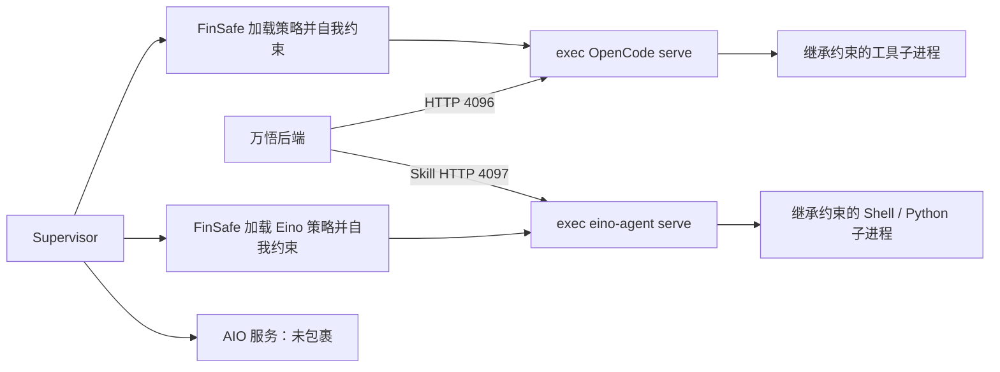

# 用 FinSafe 包裹万悟的 OpenCode 和 Eino 执行端

通过派生镜像替换 Supervisor 的 OpenCode、`eino-agent` 启动配置，不修改业务源码。
原镜像入口 `/opt/gem/run.sh`、HTTP API、4096/4097 端口和技能挂载保持原样。
此覆盖配置同时适用于 `wga-sandbox` 和 `wga-sandbox-ontology`；只启动需要的服务。



两个执行端分别通过 `self-confine` 应用策略后 exec，各自进入 FinSafe cgroup。
Supervisor 管理最终服务进程，退出码和信号直接传递；初始化失败时不启动裸服务。
Eino 原有命令检查、Skill 变量保护和中间件继续生效；本接入不设置关闭它们的开关。

## 运行条件

- **原生 Linux x86_64** Docker daemon、cgroup v2、Landlock 和 seccomp。
  本次固定使用官方 `v0.11.19` Linux x64 发行包并校验发布的 SHA-256，保留全部伴随程序。
- ARM64 主机上的 x64 模拟运行不能代替原生隔离验证。当前覆盖配置不提供 ARM64 发行包。
- Linux daemon 主机上有专用、可写的 cgroup 委派目录。只把该子树映射进容器，
  不挂载整台主机的 cgroup 树，不增加 `privileged` 或 Docker socket。
  本说明以 rootful Docker 为前提，rootless/userns-remap 尚未验收。
- 容器继承原 Compose 中的 `seccomp=unconfined`；两个执行端由 FinSafe 再施加自己的
  seccomp、Landlock 和资源限制。`allow_fallback: false`，不做无保护降级。

参考：[官方发行包](https://github.com/finogeeks/finsafe/releases/tag/v0.11.19)、
[Linux 安装说明](https://github.com/finogeeks/finsafe/blob/main/docs/en/getting-started/install.md#linux)。

## 启用

在 **Docker daemon 所在的 Linux 主机**准备专用 cgroup，重启主机后需重新建立，
或由主机的 systemd/配置管理持久化此委派。以下命令只创建万悟专用子树，
父级需要已经启用 cpu、memory、pids 控制器：

```bash
sudo mkdir -p /sys/fs/cgroup/finsafe-wanwu/finsafe.slice
printf '+cpu +memory +pids\n' | sudo tee /sys/fs/cgroup/finsafe-wanwu/cgroup.subtree_control
printf '+cpu +memory +pids\n' | sudo tee /sys/fs/cgroup/finsafe-wanwu/finsafe.slice/cgroup.subtree_control
```

不要对 cgroup 目录执行 `chmod 777`。本次沿用原服务的 root 用户，由 FinSafe
约束其访问范围；是否采用用户命名空间或非 root 运行，需要另行配置和验证。

在仓库根目录沿用已有 `.env`、`.env.ontology`，增加覆盖配置：

```bash
cp .env.finsafe.example .env.finsafe

docker compose --env-file .env.image.amd64 --env-file .env --env-file .env.ontology \
  --env-file .env.finsafe -f docker-compose.yaml -f docker-compose.finsafe.yaml \
  build wga-sandbox

docker compose --env-file .env.image.amd64 --env-file .env --env-file .env.ontology \
  --env-file .env.finsafe -f docker-compose.yaml -f docker-compose.finsafe.yaml \
  up -d --no-deps wga-sandbox
```

如未配置本体功能，可省略 `--env-file .env.ontology`。如启用本体执行沙箱，
再执行同样的 `up` 命令，服务名改为 `wga-sandbox-ontology`。
它复用已经构建的派生镜像，使用各自的进程和 cgroup 配额。

覆盖配置会保留原有技能 volumes，并增加只读策略挂载。健康检查同时要求
OpenCode `/global/health`、Eino `4097/health` 和 AIO 8080 可用，避免执行端启动失败
时仍显示健康。
后续管理这些沙箱时应一直带上该覆盖配置；普通的原始 Compose 启动命令会还原镜像。

## 策略范围

`opencode.yaml` 允许写入 `/home/root/workspace`、OpenCode 的配置/状态/缓存、
npm 缓存和 `/tmp`；工具及技能路径只读。显式固定 OpenCode 的 HOME 和 XDG
目录到 `/home/root`，避免宿主镜像入口的环境差异影响状态路径。模型配置仍由
万悟写入任务目录中的 `.opencode/opencode.json`。

`eino-agent.yaml` 允许写入同一任务工作区、`/tmp`、`/home/root/.cache` 和 npm 缓存，
程序、配置和技能目录按只读意图配置。服务 HOME/XDG 同样固定到 `/home/root`。
任务的 `.env` 和 `.skill_env.json` 由现有协议准备；不将真实模型 key 打入镜像。

万悟任务中的 `.env` 可读写，因此关闭 FinSafe 的默认敏感文件名过滤。策略声明了
SSH、云凭据、Kubernetes 凭据目录、shadow 文件和 Docker socket 的拒绝读取意图；
本次兼容性用例不证明这些 `deny_read_paths` 在 self-confine 后端全部生效。
此前旧版 ARM 运行时曾未满足此项，不能据此承诺本接入已完成敏感读取防护。
FinSafe 编译器会增加工作目录祖先的读取权限；路径清单并不代表所有祖先下的文件
都不可读，不应在这个共享容器中存放其他用户的秘密。
现有 `/root` 下的 OpenCode 登录状态不会自动迁移到新的状态目录；使用独立登录
凭据的部署需要由运维迁移必要文件。万悟按任务下发模型配置的路径不依赖此迁移。

默认每个执行服务进程树的上限为内存 4G、512 个进程、2 个 CPU 配额；
没有服务运行时长上限。这些是整个服务的额度，并非每个会话分别计量。
两个服务使用各自的 FinSafe cgroup；这些额度不会预留内存，也不等于逐任务配额。

8GB 主平台的 worker、缓存及共同父 cgroup 总预算见
[低内存部署配置](../low-memory/README.md)。FinSafe 移动进程后，Docker 单独的
`mem_limit` 不能代表整个执行进程树的额度；该配置使用共同父组约束合计内存。

**本次建立 OpenCode、eino-agent 本身及其子进程的直接执行边界。**
`network: host` 在这里共享的是容器的网络命名空间，不会启用 Docker host networking，
也不会限制出站网络。`agent-service`、BFF、AIO `/v1/shell/exec`、文件 API 和远程
MCP 未纳入包装。网络请求由独立执行服务处理时，不会自动继承调用方的约束；
`eino-agent` 是独立应用自己的 FinSafe 策略，并非从 OpenCode 跨 HTTP 继承。
因此本方案不能宣称防住了通过这些 API 的间接越界访问，也不提供会话间的强隔离。
若需要完整工具边界，需继续约束这些执行端或隔离它们的访问网络。

`/proc` 只读用于运行时兼容；本次没有新增 PID 命名空间，不能据此宣称与容器内
其他进程之间有完整的信息隔离。政策变更应按实际任务验证，不能只检查服务能启动。

## 验证与故障定位

服务启动后，在仓库根目录运行：

```bash
sh deploy/finsafe/verify.sh
# 本体沙箱（如使用）：
sh deploy/finsafe/verify.sh wga-sandbox-ontology
```

脚本不调用模型，检查两个执行端健康接口、实际 server PID 的 cgroup、seccomp、
NoNewPrivs，并分别在两个策略下验证子进程写工作区、读写任务 `.env`、
拒绝越界写入、拒绝修改策略文件。合成文件的读取只输出诊断，不作为敏感读取
隔离已生效的证明。临时文件会清理，不读取真实凭据。
直接运行 `docker compose exec ... sh` 是运维操作，不会自动进入 OpenCode 的约束；
脚本明确通过同一 FinSafe 策略启动探测进程。

还需在万悟界面完成一次真实任务：在工作区生成文件、读取并总结该文件，确认文件、
模型调用和 SSE 返回正常。这一步需要部署自己的模型配置，脚本的通过不能替代它。

查看 Supervisor 的 `/var/log/gem/opencode.log`，应有 FinSafe 的策略 digest 和
`self-confine applied ... execing broker`，随后才是 OpenCode 的启动日志。
缺少控制器、cgroup 只读、Landlock/seccomp 不支持或策略拒绝路径时，按日志修复
主机委派或具体策略；不要改成允许 fallback，也不要用 `--audit` 作为正式启动命令
（Linux audit 模式可能放宽 seccomp）。

Eino 增量接入与 OpenCode 回归见 [EINO-VALIDATION.md](EINO-VALIDATION.md)。
原始两阶段验证见 [VALIDATION.md](VALIDATION.md)。
完整主平台使用 DeepSeek 的界面任务、下载文件核对及已知问题见
[UI-VALIDATION.md](UI-VALIDATION.md)。

## OpenCode 使用 DeepSeek

独立使用 OpenCode 时，可将 [示例配置](examples/opencode-deepseek.json) 放到
`/home/root/.config/opencode/opencode.json`。官方地址为
`https://api.deepseek.com/v1`，模型配置为 `deepseek/deepseek-flash`。
API key 通过运行时环境变量 `DEEPSEEK_API_KEY` 提供，配置文件使用
`{env:DEEPSEEK_API_KEY}` 引用，不要将真实 key 写进 Dockerfile 或提交到仓库。

经万悟调用时，仍由万悟的模型配置下发到任务目录：供应商 `deepseek`、模型名
`deepseek-flash`、Base URL `https://api.deepseek.com/v1`，使用运维提供的 key。
全局示例配置适合独立调试，任务配置以万悟实际下发值为准。

本机直连官方 API 的 TLS 连接超时，通过已有 HTTP 代理后真实调用成功。
若 Docker Desktop 中也需使用该代理，可在容器运行时设置
`HTTP_PROXY` 和 `HTTPS_PROXY` 为 `http://host.docker.internal:1087`，
并设置 `NO_PROXY=localhost,127.0.0.1,::1`。这是本机代理地址，
Linux 服务器应按其实际网络填写；能直接访问官方 API 时无需代理。

## 回退

使用原始 Compose 配置重新创建对应服务即可恢复原镜像：

```bash
docker compose --env-file .env.image.amd64 --env-file .env --env-file .env.ontology \
  -f docker-compose.yaml up -d --no-deps --force-recreate wga-sandbox
```

本体沙箱需要分别回退。此回退会明确移除 FinSafe 保护。不要在服务仍运行时删除
其 cgroup 目录；停用全部相关沙箱后，再由主机运维清理专用子树中的空 cgroup。
